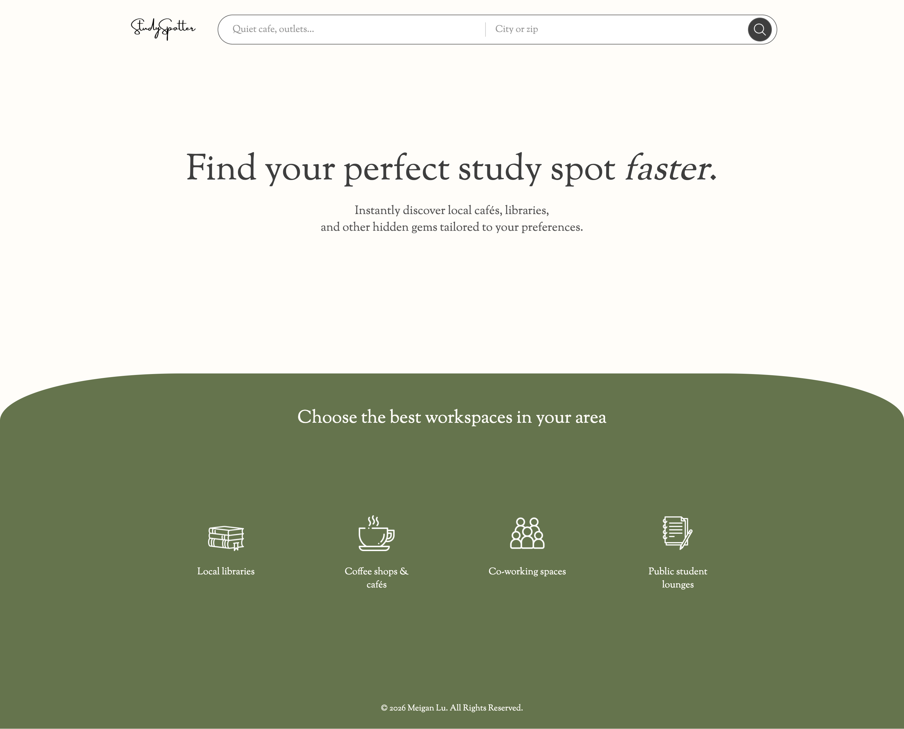

# StudySpotter
 
StudySpotter is a study spot finder to help students and others alike to find the best local study spots. This tool is meant to streamline and optimize finding the perfect study spot based on a person's study needs, ranking places by what reviewers actually say about them.
 
 
## Core Features
 
* **Search Functionality**: Search for local study spots by location and describe what you need (e.g., "quiet cafe with outlets")
* **Semantic Ranking**: Results are ranked by how closely a place's Google reviews match your needs, using OpenAI embeddings and cosine similarity, combined with a review-based study score and a weighted Google rating
* **Interactive Map**: Navigate study locations using Google Maps integration, alongside a paginated list view
* **Review Highlights**: See each spot's photo, address, rating, and the top study features mentioned in its reviews (e.g., wifi, outlets, quiet)
* **Convenient Filtering**: Refine search results by rating and category to match user preferences
## Tech Stack
 
* Next.js
* TypeScript
* Tailwind CSS
* Google Maps JavaScript API
* Google Places API (New)
* Google Geocoding API
* OpenAI Embeddings API (`text-embedding-3-small`)
## Getting Started Locally
 
### Prerequisites
- Make sure to have Google Maps API key ready
- Make sure to have OpenAI API key ready (used for semantic ranking)
### Setup
1. Clone the repository
2. Install dependencies:
```
npm install
```
 
3. Create `.env.local` and add your Google Maps and OpenAI API keys
```
NEXT_PUBLIC_GOOGLE_MAPS_API_KEY=your_api_key
OPENAI_API_KEY=your_api_key
```
 
> If the OpenAI key is missing or ranking fails, results fall back to sorting by weighted rating.
 
4. Now run the development server!
```
npm run dev
```
 
 
### API Key Setup
 
1. Enable these Google Cloud APIs:
```
Maps JavaScript API
Places API (New)
Geocoding API
```
 
 
## Future Features
 
* Ability to have user login and authentification
* Ability to save study spots
## Visual Overview
